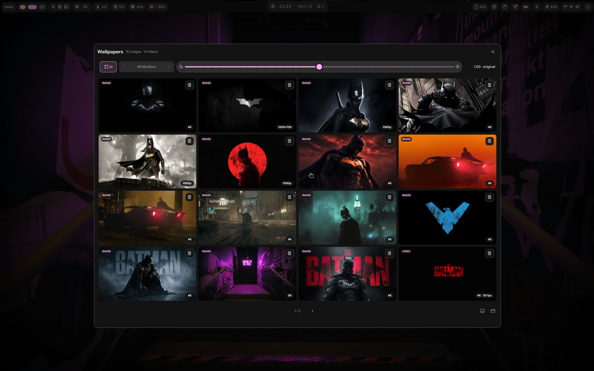

# MpvPaper Plugin

A video and image wallpaper chooser for [Dank Material Shell (DMS)](https://github.com/AvengeMedia/DankMaterialShell). It brings still and animated wallpapers together in one monitor-aware chooser, with per-wallpaper gamma controls and synchronized video playback.



## Features

### Unified wallpaper chooser

- Browse images and videos in one large, paged grid.
- Keep images and videos grouped while sorting each group automatically by representative color.
- Scroll the mouse wheel over the chooser to move between pages.
- Hover over a video tile to preview it in the cover; moving away restores the cover image.
- See each item’s resolution and, for videos, frame rate.
- Move an unwanted image or video to the desktop Trash from its tile. The original file is not permanently deleted.
- Choose a specific monitor or apply a wallpaper to all monitors.

### Gamma correction

- Adjust image and video gamma with the slider in the chooser; changes apply immediately without an Apply button.
- Each image and video keeps its own saved gamma value.
- The slider covers 0.25–2.00, uses fine steps, and places the original value (1.00) at the center.
- Still-image corrections are generated in a cache, leaving the source image untouched. Video gamma is changed live through mpv’s IPC interface.

### Video playback

- Play video wallpapers through `mpvpaper` and switch wallpapers with a transition guard to avoid flashes.
- Keep monitors playing the same file aligned, including when the file is assigned separately to each monitor.
- Support the hardware-decoding modes exposed by mpvpaper and configure fill mode, volume, lock-screen behavior, and optional player settings.
- Pause on fullscreen applications and resume when appropriate, depending on the plugin settings.
- The settings interface supports English and Simplified Chinese.

## Screenshot

The screenshot above shows the combined chooser, monitor selector, gamma slider, image/video badges, and tile actions.

## Requirements

- Dank Material Shell 1.6.2 or later
- `mpvpaper` for video wallpapers
- `ffmpeg` (including `ffprobe`) for video thumbnails, metadata, and color sampling
- Python 3 and Pillow for automatic color sorting
- ImageMagick (`magick`) for cached gamma-corrected still images
- DMS's `dms trash put` command for moving files to the desktop Trash

Hardware video decoding is optional. The selected decoder depends on the installed graphics drivers and mpvpaper build.

### Install on Debian 13

Install the plugin's runtime tools:

```sh
sudo apt update
sudo apt install ffmpeg python3-pil imagemagick
```

The DMS shell itself must already be installed; its `dms trash` command handles Trash operations.

If `mpvpaper` is not available from your enabled APT repositories, install its build dependencies and compile it from the upstream source:

```sh
sudo apt install build-essential git meson ninja-build pkg-config \
  libmpv-dev libwayland-dev libegl-dev wayland-protocols

git clone https://github.com/GhostNaN/mpvpaper.git
cd mpvpaper
meson setup build --prefix=/usr/local
ninja -C build
sudo ninja -C build install
```

The upstream build instructions and dependency list are in the [mpvpaper README](https://github.com/GhostNaN/mpvpaper#building). If your distribution provides a compatible `mpvpaper` package, install that package instead of building from source.

## Install

Install and enable **MpvPaper Plugin** from the DMS plugin browser. For local development, copy this directory into the DMS plugins folder while preserving the `mpvpaper` directory name (the plugin ID is `mpvpaper`), then reload the plugin:

```sh
mkdir -p ~/.config/DankMaterialShell/plugins
cp -a /path/to/dms-wallpaper-studio ~/.config/DankMaterialShell/plugins/mpvpaper
dms ipc call plugins reload mpvpaper
```

If the plugin is already installed at that path, back it up before replacing it. The DMS plugin directory can differ by installation; use the directory configured by your DMS setup.

## Use

1. Enable the plugin in DMS. Add video files or a folder from its settings page; the chooser also uses wallpaper images exposed by DMS.
2. Open the wallpaper chooser from the plugin’s DankBar widget.
3. Select **All** to use the same wallpaper across monitors, or select a monitor to set its wallpaper individually.
4. Click an image or video tile to apply it. Drag the gamma slider to adjust that item; the value is saved automatically.
5. Use the page controls or mouse wheel to browse the library. Hover over a video tile for its preview.

## Performance note

`mpvpaper` runs a player for each output. A high-resolution, high-frame-rate video can therefore use substantial CPU and GPU resources when displayed on several monitors. Hardware decoding reduces the video-decoding work, but each output still needs frame scheduling, rendering, scaling, and compositing. For lower system load, prefer videos around 24–60 fps; a 4K 240 fps wallpaper can be much more demanding.

## Project files

| File | Purpose |
| --- | --- |
| `MpvPaperWidget.qml` | Wallpaper chooser, previews, paging, monitor controls, gamma slider, and tile actions |
| `MpvPaperDaemon.qml` | mpvpaper process lifecycle, transitions, IPC, pause behavior, and playback synchronization |
| `MpvPaperSettings.qml` | Plugin configuration and video-library management |
| `MpvPaperTransition.qml` | Transition overlay used while a new video starts |
| `color_sort.py` | Cached representative-color analysis for image and video files |
| `gamma_cache.py` | Generates cached gamma-corrected images without changing the originals |
| `plugin.json` | DMS plugin manifest |

## Credits and license

The original MpvPaper Plugin was created by tokisak1kurum1. The MIT license and original copyright notice are included in [`LICENSE`](LICENSE). Dank Material Shell, mpvpaper, and the other referenced projects retain their own licenses and trademarks.
